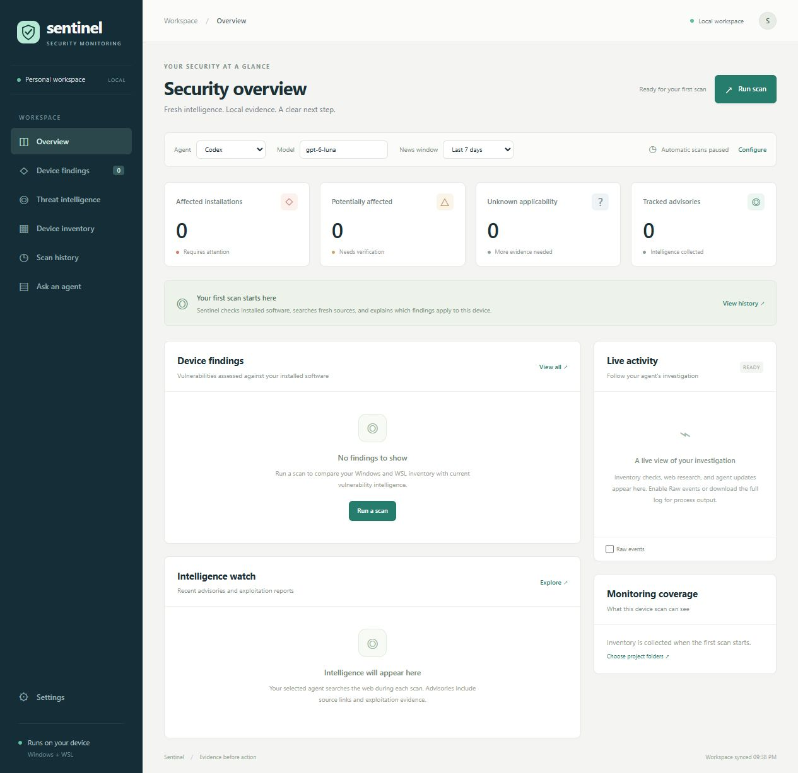
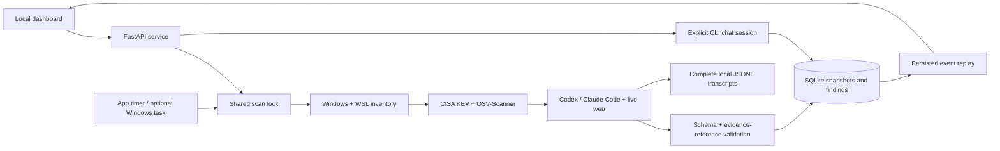

# Sentinel · Local vulnerability monitoring

A local Windows + WSL dashboard that combines observed software inventory, CISA known-exploitation intelligence, OSV dependency checks, and live web research by **Codex or Claude Code**. Findings explain which installation an advisory may affect, cite the evidence, and propose fixes to inspect and copy.

## Method and quick start

Each investigation collects Windows/WSL versions, scans explicitly configured project folders with OSV-Scanner, fetches CISA KEV, then asks the selected agent to research vendor advisories and exploitation reports. Validated records are saved in SQLite and streamed to the dashboard. Assessments distinguish **affected**, **potentially affected**, **not affected**, and **unknown**; exploitation evidence is tracked separately. See [coverage and evidence boundaries](docs/coverage.md).

Run in **native Windows PowerShell**. Install [uv](https://docs.astral.sh/uv/getting-started/installation/), the [native Codex CLI](https://learn.chatgpt.com/docs/enterprise/windows-deployment) and/or [Claude Code](https://code.claude.com/docs/en/setup), plus [OSV-Scanner v2](https://google.github.io/osv-scanner/installation/). Complete `codex login` and/or `claude auth login` under your Windows account. The [setup guide](docs/setup.md#install-tools-and-sign-in) includes installation commands, executable-path troubleshooting, and WSL scanner setup.

```powershell
git clone https://github.com/BurnyCoder/security-monitoring-agent.git
cd security-monitoring-agent
uv sync --locked
Copy-Item .env.example .env
uv run security-monitoring-agent diagnostics
uv run security-monitoring-agent serve
```

Open [the dashboard](http://127.0.0.1:8765). Choose a provider and model, then **Run scan**. The default model is `gpt-6-luna`; choose `haiku` with Claude Code. Model names are editable and the CLI reports account/model restrictions. No API key is required for subscription CLI authentication.

Automatic monitoring defaults to **60 minutes** while the server runs, with one initial scan on a new workspace. The news window defaults to seven days and supports one or thirty days. Closing the browser leaves monitoring running; stopping the server stops its timer. Pause automatic scans or opt into login/standalone Windows scheduling in **Settings**. The default dependency root is this repository alone. Additional Windows folders and WSL distribution/path pairs are explicit settings.



*Actual application screenshot from an empty workspace, paused for documentation. No sample findings or device inventory are published.*

## Features

- Device findings with severity, applicability, exploitation, platform, and source filters; older unresolved findings remain visible.
- News with source links and distinct publication, modification, KEV-addition, and observation dates.
- Inventory and coverage views, durable scan history, cancellation, and reconnectable live activity.
- Finding details with recorded versions, installation evidence, uncertainty, shell/distro, elevation, restart, and verification instructions. Remediation is **show-and-copy only**.
- Follow-up chat with inventory/finding context and an explicit, persisted CLI session per conversation.
- Shared manual/timer/standalone scan lock, restart recovery, atomic `.env` edits, and complete timestamped local transcripts.

Codex runs with live web search and `--dangerously-bypass-approvals-and-sandbox`; Claude runs with `--dangerously-skip-permissions` and sandbox disabled. The application adds no agent sandbox or approval layer. Prompts scope the task to research, inspection, and proposed fixes; these instructions are not an enforcement boundary. Both CLIs retain access permitted by the signed-in account and their own configuration. See the [runtime architecture](docs/architecture.md).

## Data flow and technology



Python, uv, FastAPI, Pydantic, SQLite/WAL, HTTPX, Portalocker, Jinja2, and browser-native JavaScript/CSS. The frontend needs no npm packages or build. Provider adapters share native subprocess launch, concurrent stream draining, timeouts, and process-tree cancellation. See [modules and API contracts](docs/architecture.md); running API documentation is at `/docs`.

## Operate and validate

```powershell
uv run security-monitoring-agent scan --once --provider codex --model gpt-6-luna
uv run security-monitoring-agent scan --once --provider claude --model haiku
uv run --locked pytest -q
node --experimental-vm-modules scripts/check_frontend.mjs
```

The [setup guide](docs/setup.md) covers all configuration fields, background scheduling, stopping the server, unavailable models, and log inspection. [Validation records](reports/README.md) distinguish fixture tests from live provider experiments and document limitations. The [PDF validation report](reports/validation-report.pdf) is a concise engineering report credited to Libor Burian.

Schema validation checks structure and evidence references; it does **not** establish the factual correctness of an agent's claims. Windows cumulative updates and distro backports require vendor-specific interpretation. Lockfile findings describe recorded dependencies, not confirmed installation or reachability. A failed source, empty result, or completed workflow never proves the device is safe. Read [coverage](docs/coverage.md) before interpreting results.

`.env`, `data/`, `logs/`, downloaded tools, credentials, and actual device inventories are excluded from Git. Full transcripts may contain local paths and provider output; they are retained on this machine without truncation or automatic rotation. Public documentation and reports contain sanitized engineering results only.
